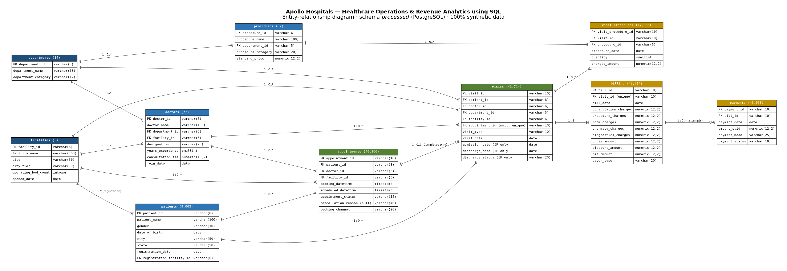
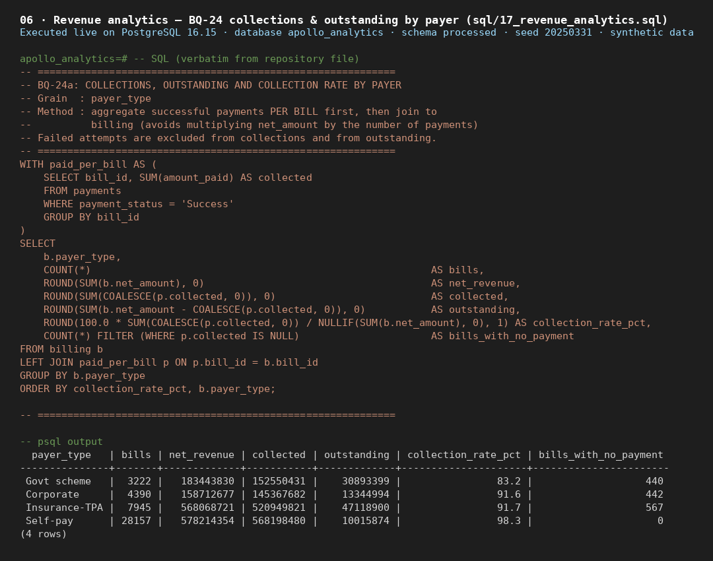
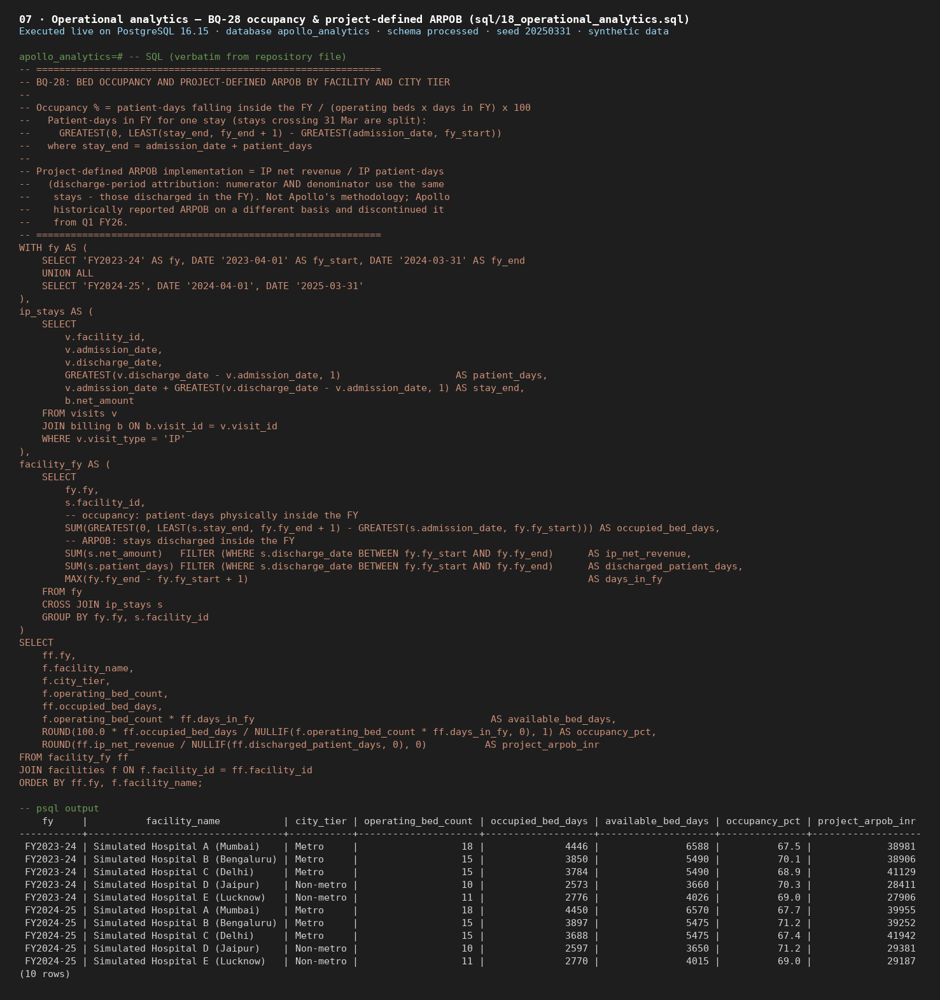
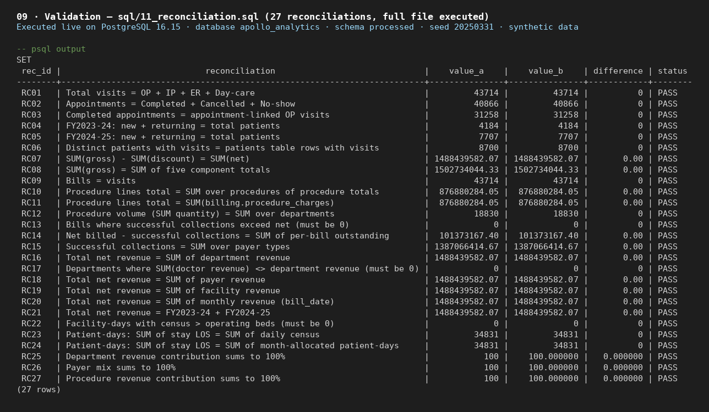

# Hospitals — Healthcare Operations & Revenue Analytics using SQL

**PostgreSQL · SQL · Git/GitHub** — an end-to-end SQL analytics project on a deterministic, fully synthetic hospital dataset.

> **Important disclaimer**
> This is an **independent portfolio project** built on **100% synthetic data** generated in PostgreSQL.
> - It does **not** contain actual Apollo Hospitals operational, financial, patient, doctor, billing or proprietary data.
> - It is not affiliated with, endorsed by or commissioned by Apollo Hospitals Enterprise Limited.
> - Apollo Hospitals is used **only as a publicly documented business-context reference** ([`business_context.md`](documentation/business_context.md)).
> - All findings describe the synthetic project dataset only.

---

## Executive summary

This project models a five-hospital multispecialty network over two Indian financial years, **1 Apr 2023 – 31 Mar 2025**. It answers **30 business questions** in SQL across:

- patient activity and retention;
- department and doctor performance;
- procedure utilisation;
- revenue, payer mix and collections;
- operational KPIs: appointment completion, ALOS, bed occupancy and a project-defined ARPOB;
- revenue trends.

Every step runs in PostgreSQL: synthetic data generation, validation, cleaning, reconciliation, KPI validation and analytics. Every reported number traces to a SQL file ([`analysis_traceability.md`](documentation/analysis_traceability.md)).

## Business context

A hospital network earns most of its revenue from a capacity-constrained inpatient business, while outpatient activity drives patient acquisition and referrals. Management needs to know:

- where volume and revenue come from;
- how concentrated revenue is across patients, departments, doctors and procedures;
- how well beds and appointment slots are used;
- how much of the billed revenue is actually collected.

## Objectives

| Area | Objectives |
|---|---|
| Patient Analytics | Volume by month, facility and service line; demographics; new vs returning; repeat rate; visit interval; spend concentration |
| Department Analytics | Rankings by visits, revenue and revenue per visit; FY revenue-mix shift; OP/IP split; 30-day OP→IP conversion |
| Doctor Analytics | Top doctors per department; above-average performers; monthly load; revenue concentration; no-show rates |
| Procedure Analytics | Volume vs revenue; contribution and Pareto; monthly trend; inpatient association |
| Revenue Analytics | Monthly and quarterly growth; charge mix; payer mix; discounts; collections and outstanding |
| Operational Analytics | Cancellation and no-show; lead-time association; ALOS; occupancy; project-defined ARPOB |
| Trend Analytics | Cumulative FY revenue; peak and trough months |
| Data Quality & Validation | Raw validation, cleaning, reconciliation and dual-method KPI validation |

## Dataset

- **Synthetic, generated entirely in PostgreSQL.** Every random draw is `md5(seed | key)`, so the same seed always reproduces the same data. Seed: `20250331`.
- **Period:** 1 Apr 2023 – 31 Mar 2025 (FY2023-24, FY2024-25).

| Table | Rows | Table | Rows |
|---|---|---|---|
| facilities | 5 (69 operating beds) | visits | 43,714 |
| departments | 14 | procedures | 57 |
| doctors | 72 | visit_procedures | 17,366 |
| patients | 9,003 | billing | 43,714 |
| appointments | 40,866 | payments | 45,058 |

**Patient counts:** 9,003 registered (processed) patients, of whom **8,700** had at least one visit. The other 303 only had cancelled or not-attended bookings. In the raw layer there are 9,121 patient records; 118 duplicate-like records are merged during cleaning.

CSV exports of both layers are in [`data/raw`](data/raw) and [`data/processed`](data/processed), about 15 MB each. The full dataset can always be regenerated with `sql/run_all.sql`.

## Data generation (high level)

```
Business rules (documented assumptions)
  → deterministic SQL generation (raw)
  → validation → cleaning → reconciliation
  → processed data → analytics
```

**Design notes:**
- Inpatient stays are laid on per-bed timelines, so daily census can never exceed operating beds.
- Realistic, documented data-quality issues are injected into `raw` (casing, whitespace, label variants, NULLs, duplicate-like patients) and cleaned in SQL.

Details: [`generation_assumptions.md`](documentation/generation_assumptions.md).

## Data model

There are 10 core tables with 16 foreign keys:
- `facilities`, `departments`, `doctors` and `patients` are the dimensions.
- `appointments` (bookings) and `visits` (encounters) are the activity tables. One appointment produces 0 or 1 visit.
- `procedures` and `visit_procedures` link procedures to visits.
- `billing` holds exactly one bill per visit.
- `payments` holds 0..* attempts per bill.



Column-level detail: [`data_dictionary.md`](documentation/data_dictionary.md).

## SQL workflow

```
Business Context
  ↓
Schema & Relationships           sql/01_schema.sql
  ↓
Synthetic Data Generation        sql/02–08
  ↓
Raw Validation                   sql/09 (on raw)
  ↓
Data Cleaning                    sql/10
  ↓
Processed Validation             sql/09 (on processed)
  ↓
Reconciliation                   sql/11
  ↓
KPI Validation                   sql/12
  ↓
Business Analytics (30 BQs)      sql/13–19
  ↓
Findings & Documentation         documentation/
```

| File | Purpose |
|---|---|
| `01_schema.sql` | Schemas `gen`, `raw` and `processed`; tables, constraints, indexes; deterministic random functions |
| `02`–`08` | Generation: reference data, patients, appointments, visits, procedures, billing, payments |
| `09_data_quality_validation.sql` | 42 checks (PASS / FAIL / DQ_FOUND), run on raw and processed |
| `10_data_cleaning.sql` | raw → processed (standardisation, duplicate merge, child remapping) |
| `11_reconciliation.sql` | 27 reconciliations |
| `12_kpi_validation.sql` | 21 KPIs, each computed two independent ways |
| `13`–`19` | Patient, department, doctor, procedure, revenue, operational and trend analytics |
| `run_all.sql` | Runs setup, generation, cleaning and validation (scripts 01–12); analytics 13–19 run separately |

The analytics SQL deliberately stays at Basic–Intermediate level: JOINs, GROUP BY/HAVING, CASE, `FILTER`, simple CTEs. Window functions (RANK, ROW_NUMBER, LAG, running SUM, NTILE, PERCENTILE_CONT) are used only where a question needs them.

## Key findings (synthetic dataset)

Each finding is tagged **Emergent** (not set by a generator parameter) or **Assumption-driven** (consistent with a documented generation assumption). Full detail is in [`analytical_findings.md`](documentation/analytical_findings.md).

| Area | Finding | Type |
|---|---|---|
| Growth | Visits grew **57.8%** FY-on-FY (16,954 → 26,760), while net revenue grew **9.9%** (₹709.0M → ₹779.5M; total ₹1,488.4M). The gap is consistent with fixed-bed inpatient capacity plus growth in lower-value OP activity | Assumption-driven |
| Returning patients | Returning share rose from 0% to about 81% per month, mostly from left-censoring. FY2024-25 repeat rate is **41.4%** | Assumption-driven |
| Revenue concentration | The top 10% of patients generate **51.2%** of net revenue; the top 20% generate 74.4% | Emergent |
| Departments | Orthopaedics leads net revenue (₹231.6M), Nephrology leads visits (4,850) and O&G leads revenue per visit (₹103.4k) | Emergent |
| OP/IP mix | IP is **85.5%** of net revenue from **16.1%** of visits | Assumption-driven |
| OP→IP (project-defined) | 30-day conversion is **31.2%** network-wide, highest in surgical departments (O&G 48.4%) | Assumption-driven |
| Procedures | 12 of 57 procedures make up 64.6% of procedure revenue. Major Surgery is 70.9% of procedure revenue from 15.8% of units | Assumption-driven |
| Collections | **₹1,387.1M** collected, **₹101.4M** outstanding. Self-pay 98.3%, Govt scheme 83.2%. The latest billing quarter shows 61.1% because of right-censoring | Assumption-driven |
| Appointments | Completed **76.5%**, Cancelled 11.7%, No-show 11.8%. No-show rates show no lead-time pattern (11.2%–12.2%) | Assumption-driven |
| ALOS | **4.83** days (FY2023-24) and **5.05** days (FY2024-25); surgical departments are longest | Assumption-driven |
| Occupancy | **67.4%–71.2%** across facility-years | Assumption-driven |
| Project-defined ARPOB | Metro ₹39.6k–40.3k vs Non-metro ₹28.1k–29.3k per patient-day | Assumption-driven |
| Trend | FY2024-25 year-to-date lead narrows from +33.5% (April) to +9.9% (March). Apr–Jun are low months in both FYs, which is consistent with the patient-base ramp and **not evidence of seasonality** | Assumption-driven |

## Screenshots

Real query outputs from PostgreSQL (more in [`screenshots/`](screenshots)).

**Collections by payer (BQ-24)**


**Occupancy and project-defined ARPOB (BQ-28)**


**Reconciliation checks (27/27 PASS)**


## Tools

PostgreSQL (version of original execution not independently confirmed; user-reported environment: 18.6) · SQL · Git/GitHub.

## How to run

```bash
createdb apollo_analytics
psql -d apollo_analytics -f sql/run_all.sql      # run from the repository root
for n in 13_patient 14_department 15_doctor 16_procedure 17_revenue 18_operational 19_trend; do
  psql -v ON_ERROR_STOP=1 -d apollo_analytics -f sql/${n}_analytics.sql
done
```

`run_all.sql` uses `\i sql/...` paths, so run it from the repository root. It rebuilds all schemas, runs scripts 01–12, prints their validation results, and finishes with row counts and a reproducibility fingerprint. Analytics scripts 13–19 are executed separately using the commands above. The shell loop shown works in Bash; on Windows PowerShell, run each of the seven `psql -v ON_ERROR_STOP=1 -d apollo_analytics -f sql/13_patient_analytics.sql` through `sql/19_trend_analytics.sql` commands separately.

## Limitations

- **Synthetic data.** Most patterns are assumption-driven by construction and are not real-world evidence.
- **Synthetic bed capacity.** Bed capacity is a synthetic simulation parameter calibrated for analytical coherence with the generated dataset volume. It does not represent actual Apollo Hospitals facility capacity.
- **Project-defined ARPOB.** Project-defined ARPOB implementation = IP net revenue ÷ IP patient-days (discharge-period attribution). It is not Apollo's methodology; Apollo historically reported ARPOB on a different basis and discontinued it from Q1 FY26.
- **Left-censoring.** History starts 1 Apr 2023, which inflates early "new" patients.
- **Right-censoring.** OP→IP excludes OP visits after 1 Mar 2025, and late-window bills are only partly settled.
- **Two FYs only, and no designed seasonality.**
- **No doctor appointment-slot capacity model.**
- **Descriptive association is not causation.**

## Documentation

| Document | Contents |
|---|---|
| [business_context.md](documentation/business_context.md) | Problem framing and sourced Apollo public context |
| [data_dictionary.md](documentation/data_dictionary.md) | All 10 tables: grain, keys, columns |
| [erd.png](documentation/erd.png) | Entity-relationship diagram |
| [kpi_definitions.md](documentation/kpi_definitions.md) | Every KPI formula and convention |
| [assumptions.md](documentation/assumptions.md) | Key assumptions for business readers |
| [generation_assumptions.md](documentation/generation_assumptions.md) | Technical generation parameters, echo-risk register, validation record |
| [data_quality_report.md](documentation/data_quality_report.md) | Validation, cleaning, reconciliation results |
| [analysis_traceability.md](documentation/analysis_traceability.md) | 30 BQs → SQL → KPI → validation → finding |
| [analytical_findings.md](documentation/analytical_findings.md) | Results, interpretation, limitations, takeaways |
| [screenshots/](screenshots) | Real psql outputs of the repository SQL |
